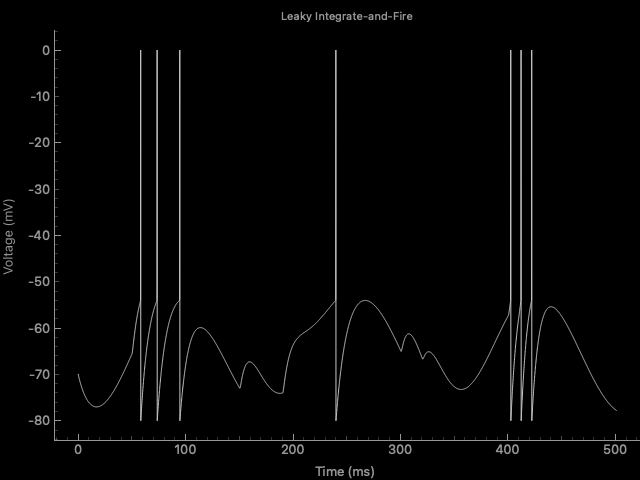
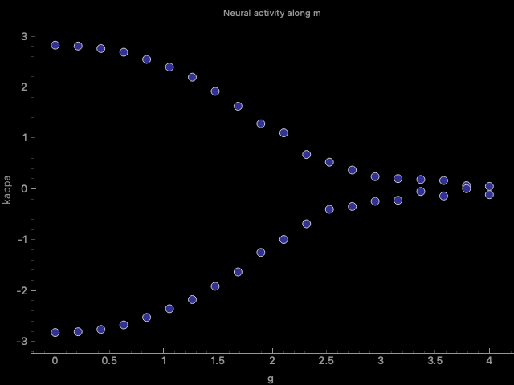

# Axel

Axel is a learning project that allows the user to carry neuroscience-related simulations.

# Features

- Leaky Integrate-And-Fire neuron model with custom input current



This figure was generated with the following input current: &#x33;*\*sin(3\**&#x32;*\*pi\**&#x74;/1000)^2

- Low-Rank RNNs simulation



Independent reproduction of Figure 1C from:

> **Mastrogiuseppe, F. & Ostojic, S., 2018. Linking connectivity, dynamics and computations in recurrent neural networks.**
> Neuron, 99(3), 609-623.
> DOI:https://doi.org/10.1016/j.neuron.2018.07.003

The figure illustrates the variation of neural activity along the structured connectivity vector \(m\) as a function of the random connectivity strength \(g\).

The results were reproduced using my own Python implementation of the model described in the original paper.

As in the original paper, the figure was obtained by simulating a network of size N = 5000, with means M<sub>m</sub> = 1.1, M<sub>n</sub> = 2.0, Σ<sub>m</sub> = Σ<sub>n</sub> = 1. 

At the moment, the software sweeps through values of g from 0 to 4 on its own, the prompted g value is only for the simulation of neurons.

## Installation

### 1. Clone the repository

```bash
git clone https://github.com/kazoud/Axel.git
cd Axel
```

### 2. Create a virtual environment

```bash
python3 -m venv .venv
```

### 3. Activate the virtual environment

**macOS / Linux:**
```bash
source .venv/bin/activate
```

**Windows:**
```bash
.venv\Scripts\activate
```

### 4. Install dependencies

```bash
pip install -r requirements.txt
```

## Usage

```bash
python main.py
```

## License

This project is licensed under the [MIT License](LICENSE).
